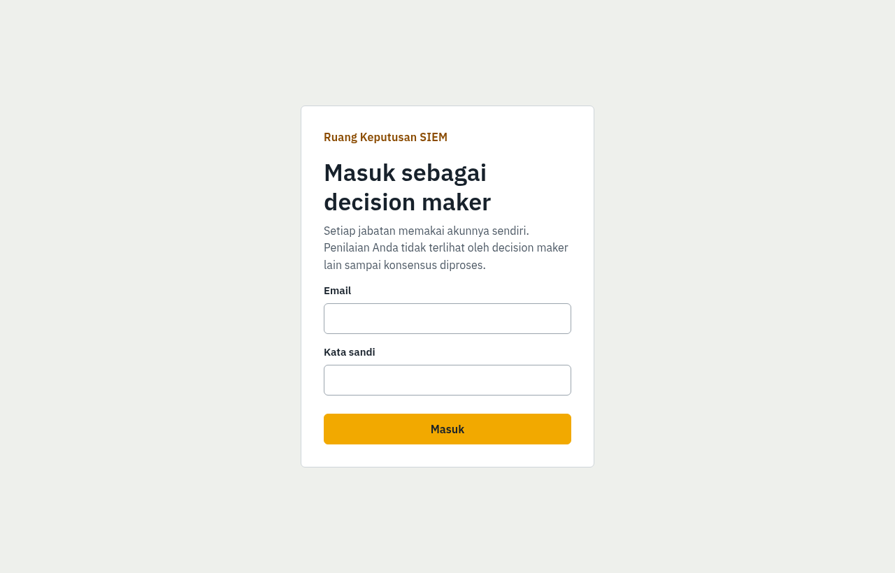
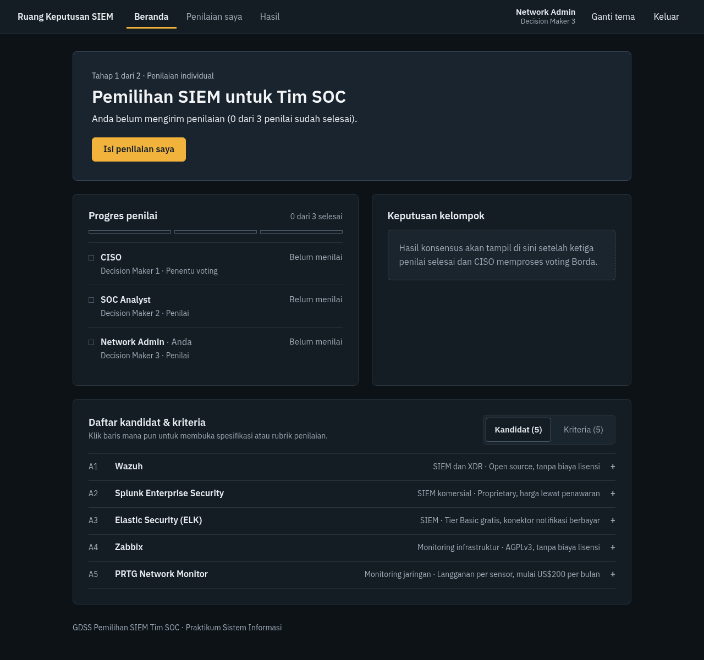
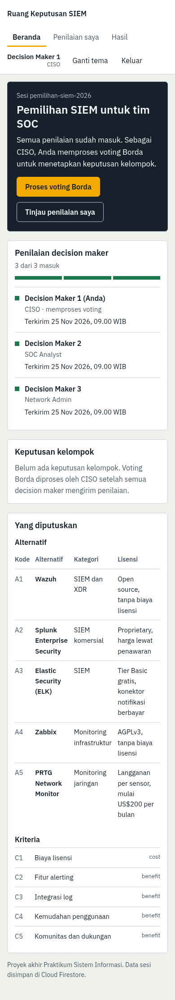
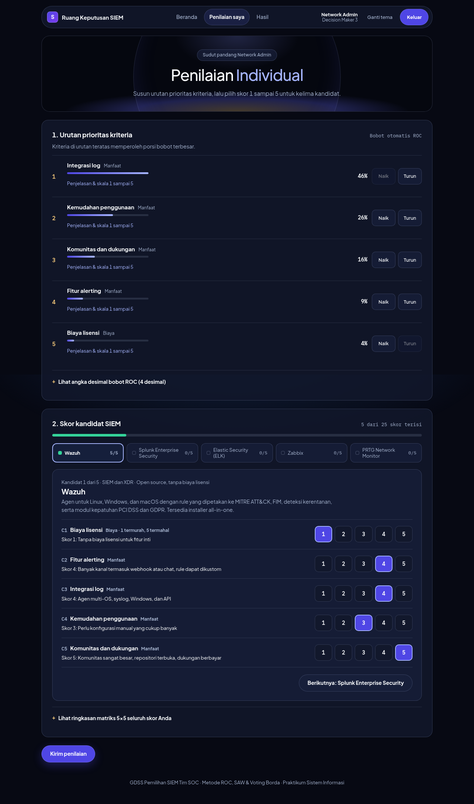
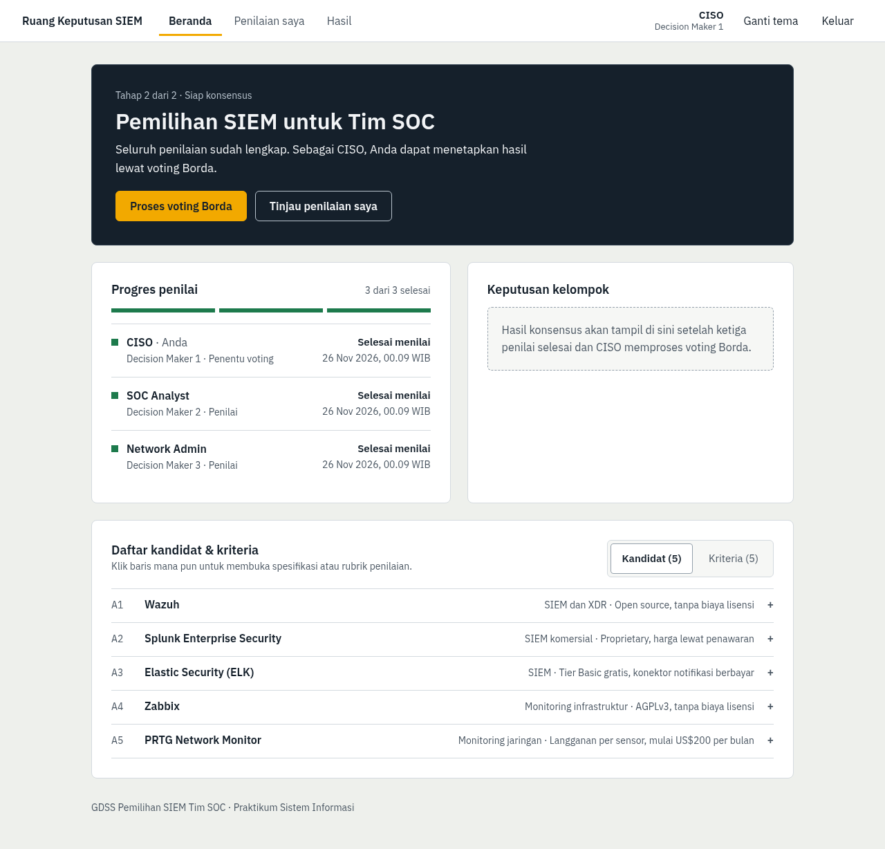
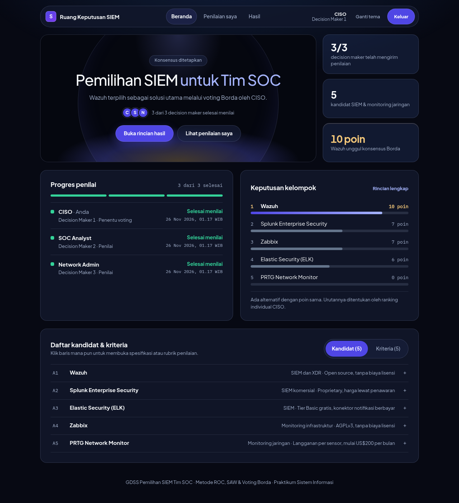
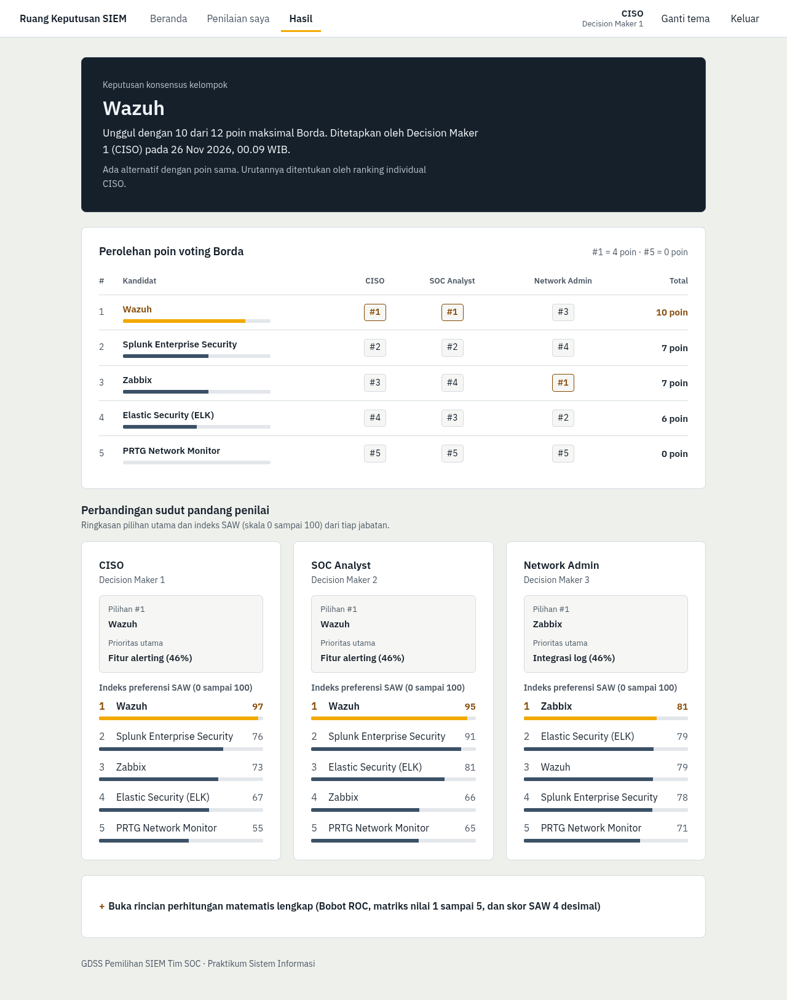

# Ruang Keputusan SIEM (GDSS Pemilihan SIEM untuk Tim SOC)

[](https://github.com/farrelfaiziaulhaq/gdss-siem/actions/workflows/ci.yml)
[](https://github.com/farrelfaiziaulhaq/gdss-siem/releases/latest)
[](https://github.com/farrelfaiziaulhaq/gdss-siem/releases/latest)
[](LICENSE)

**Group Decision Support System (GDSS)** berbasis web untuk memilih solusi *Security Information and Event Management* (SIEM) atau alat monitoring jaringan bagi tim *Security Operation Center* (SOC).

Dibangun dengan **Rust (Leptos 0.8 Full-Stack: Axum SSR + WASM Hydrate)** dan **Firebase (Firebase Auth + Cloud Firestore)** untuk **Proyek Akhir / UAS Mata Kuliah Praktikum Sistem Informasi** (Dosen Pengampu: Ibu Ashri Shabrina Afrah, M.T.). Mendukung penuh **Windows 10/11** maupun **Linux**.

---

## Daftar Isi

1. [Cara Paling Mudah: Jalankan dari Release (Tanpa Install Rust!)](#1-cara-paling-mudah-jalankan-dari-release-tanpa-install-rust)
2. [Jalankan dari Source Code (Windows & Linux)](#2-jalankan-dari-source-code-windows--linux)
3. [Akun Demo (3 Decision Maker)](#3-akun-demo-3-decision-maker)
4. [Demo Visual & Langkah-langkah Penggunaan](#4-demo-visual--langkah-langkah-penggunaan)
5. [Bukti Pemenuhan Ketentuan UAS Praktikum Sistem Informasi](#5-bukti-pemenuhan-ketentuan-uas-praktikum-sistem-informasi)
6. [Ringkasan Kriteria, Alternatif, dan Metode](#6-ringkasan-kriteria-alternatif-dan-metode)
7. [Struktur Proyek & CI/CD](#7-struktur-proyek--cicd)

---

## 1. Cara Paling Mudah: Jalankan dari Release (Tanpa Install Rust!)

Rekomendasi utama untuk teman kelompok dan saat presentasi: unduh paket siap pakai dari halaman **[GitHub Releases](https://github.com/farrelfaiziaulhaq/gdss-siem/releases/latest)**. Anda **tidak perlu** menginstal Rust, Visual Studio C++ Build Tools, ataupun menunggu kompilasi.

### A. Windows 10 / 11 (`x86_64`)

1. Buka **[Releases Terbaru](https://github.com/farrelfaiziaulhaq/gdss-siem/releases/latest)** lalu unduh **`gdss-siem-v1.0.0-windows-x86_64.zip`**.
2. Klik kanan file `.zip` tersebut lalu pilih **Extract All...**
3. Di dalam folder hasil ekstrak, cukup **klik dua kali `start.bat`**:
   - Skrip otomatis memeriksa (dan bila ada `winget`, ikut membantu memasang) **Python 3**, **Java JRE 21** (untuk Firestore Emulator), **Node.js**, serta **Firebase CLI**.
   - Menyalakan Firebase Emulator di latar belakang, membuat 3 akun & data awal secara otomatis, menjalankan `gdss-siem.exe`, lalu **membuka `http://127.0.0.1:3000` di browser**.
   - Untuk berhenti, cukup tutup jendela terminal atau tekan `Ctrl+C` (emulator ikut dimatikan bersih).

File peluncur siap klik lainnya di dalam folder rilis Windows:
- **`start.bat`** : menjalankan aplikasi secara normal (data sesi tersimpan selama folder tidak dihapus).
- **`demo-siap-voting.bat`** : mereset dan langsung mengisi penilaian contoh ketiga *decision maker*, sehingga Anda tinggal login sebagai CISO dan menekan tombol **Proses voting Borda**.
- **`reset-data.bat`** : mengosongkan kembali seluruh penilaian untuk demo pengisian dari nol.

### B. Linux (`x86_64`)

```bash
curl -fL https://github.com/farrelfaiziaulhaq/gdss-siem/releases/latest/download/gdss-siem-v1.0.0-linux-x86_64.tar.gz | tar -xz
cd gdss-siem-v1.0.0-linux-x86_64
./start.sh
```

Opsi tambahan: `./start.sh --reset` (reset data awal) atau `./start.sh --contoh` (isi penilaian contoh 3 DM).

---

## 2. Jalankan dari Source Code (Windows & Linux)

Jika ingin memodifikasi kode dan membangun langsung dari repositori Git:

### Windows (PowerShell / File Explorer)

```powershell
git clone https://github.com/farrelfaiziaulhaq/gdss-siem.git
cd gdss-siem

# Klik dua kali run.bat di File Explorer, ATAU jalankan di PowerShell:
.\run.ps1
```

### Linux (Bash)

```bash
git clone https://github.com/farrelfaiziaulhaq/gdss-siem.git
cd gdss-siem
./run.sh
```

`run.ps1` / `run.sh` otomatis memanggil `setup.ps1` / `setup.sh` bila dependensi belum lengkap, menyalakan Firebase Emulator, mengisi akun & data awal, lalu menjalankan server di **http://127.0.0.1:3000**.

| Aksi | Perintah Windows (PowerShell) | Perintah Linux (Bash) |
|------|-------------------------------|-----------------------|
| Pasang semua dependensi saja | `.\setup.ps1` (atau klik `setup.bat`) | `./setup.sh` |
| Jalankan aplikasi | `.\run.ps1` (atau klik `run.bat`) | `./run.sh` |
| Reset data ke awal (0/3 menilai) | `.\run.ps1 -Reset` | `./run.sh --reset` |
| Isi penilaian contoh 3 DM | `.\run.ps1 -Contoh` | `./run.sh --contoh` |
| Build & jalankan mode release | `.\run.ps1 -Release` | `./run.sh --release` |
| Kemas arsip rilis mandiri | `.\scripts\package_release.ps1` | `bash scripts/package_release.sh` |

> Catatan kompilasi dari source di Windows: kompilasi Rust pada Windows membutuhkan komponen *Desktop development with C++* (Visual Studio Build Tools). Bila tidak ingin memasangnya, gunakan paket **Release `.zip` Windows** pada Bagian 1.

---

## 3. Akun Demo (3 Decision Maker)

Setiap jabatan memiliki akun terpisah di Firebase Auth dan level hierarki di Firestore:

| Level | Jabatan | Email | Kata Sandi | Wewenang Khusus |
|:-----:|---------|-------|------------|-----------------|
| **3 (Tertinggi)** | **CISO** | `ciso@gdss-siem.test` | `ciso-gdss-2026` | Menilai secara individual **dan** mengeksekusi **Voting Borda** setelah semua DM selesai |
| **2** | **SOC Analyst** | `soc@gdss-siem.test` | `soc-gdss-2026` | Menilai secara individual & melihat hasil konsensus |
| **1** | **Network Admin** | `netadmin@gdss-siem.test` | `netadmin-gdss-2026` | Menilai secara individual & melihat hasil konsensus |

Saat aplikasi berjalan, dasbor Firebase Emulator juga dapat dibuka di **http://127.0.0.1:4000** untuk memperlihatkan isi koleksi Firestore dan akun Auth secara langsung saat demo.

---

## 4. Demo Visual & Langkah-langkah Penggunaan

### Langkah 1: Masuk dengan Akun Decision Maker (`/login`)

Buka `http://127.0.0.1:3000`. Pengguna yang belum masuk otomatis diarahkan ke `/login`. Masuk memakai salah satu akun pada tabel di atas (misalnya dimulai dari `netadmin@gdss-siem.test`).



---

### Langkah 2: Pantau Status Sesi di Beranda (`/`)

Halaman Beranda menampilkan status sesi saat ini, progres pengiriman penilaian ketiga *decision maker* (indikator lampu status), panel keputusan kelompok, serta daftar alternatif dan kriteria. Tersedia tombol **Ganti tema** (terang/gelap) di kanan atas yang tersimpan di `localStorage`.

| Mode Gelap (Kondisi Awal 0/3 Masuk) | Mode Mobile Responsif (390px) |
|---|---|
|  |  |

---

### Langkah 3: Isi Penilaian Individual oleh Tiap Decision Maker (`/penilaian`)

Klik **Isi penilaian saya** (atau menu **Penilaian saya**):
1. **Atur prioritas kriteria** menggunakan tombol **Naik** / **Turun** sesuai sudut pandang jabatan. Sistem menghitung bobot **Rank Order Centroid (ROC)** secara otomatis. Rubrik skala 1 sampai 5 dapat dibuka pada tiap kriteria.
2. **Beri skor 1 sampai 5** pada ke-5 alternatif untuk setiap kriteria (total 25 isian).
3. Klik **Kirim penilaian**. Server menghitung normalisasi dan skor preferensi **Simple Additive Weighting (SAW)** lalu menyimpan ranking individual DM tersebut ke Firestore. Selama konsensus belum diproses, penilaian DM lain tetap tersembunyi agar penilaian bersifat independen.

Ulangi langkah keluar dan masuk untuk ketiga akun (`Network Admin`, `SOC Analyst`, dan `CISO`).



---

### Langkah 4: Eksekusi Konsensus Voting Borda oleh Jabatan Tertinggi (`CISO`)

Setelah ketiga *decision maker* mengirim penilaian (`3 dari 3 masuk`), masuk sebagai **CISO** (`ciso@gdss-siem.test`). Hanya pada akun berjabatan tertinggi ini tombol **Proses voting Borda** muncul dan dapat dieksekusi; pada akun `SOC Analyst` maupun `Network Admin`, sistem menampilkan status menunggu CISO dan menolak pemanggilan fungsi konsensus di sisi server.



---

### Langkah 5: Lihat Hasil Konsensus dari Semua Akun (`/hasil`)

Begitu CISO menekan **Proses voting Borda**:
- Penilaian seluruh DM dikunci (hanya-baca) agar integritas keputusan terjaga.
- Beranda menampilkan pemenang konsensus beserta perolehan poin Borda seluruh alternatif dan catatan pemecah seri (bila ada poin seri, diputuskan mengikuti ranking individual jabatan tertinggi).
- Halaman **Hasil** (`/hasil`) terbuka bagi **semua decision maker** (`CISO`, `SOC Analyst`, maupun `Network Admin`), memuat tabel rekap konversi peringkat ke poin Borda serta rincian bobot ROC dan skor SAW tiap DM.





---

## 5. Bukti Pemenuhan Ketentuan UAS Praktikum Sistem Informasi

Tabel berikut memetakan setiap butir ketentuan tugas akhir pada spesifikasi mata kuliah ke implementasi di repositori ini:

| No | Ketentuan Proyek Akhir | Status | Bukti Implementasi & Lokasi Kode |
|:--:|------------------------|:------:|----------------------------------|
| **1** | **Tema bebas (dipilih kelompok)** | Terpenuhi | Tema: **Pemilihan SIEM / Tools Monitoring Jaringan untuk Tim SOC**. Latar belakang menggunakan data resmi LKj BSSN 2025, kronologi insiden PDNS 2 Juni 2024, dan regulasi keamanan siber Indonesia di [`docs/RANCANGAN.md`](docs/RANCANGAN.md) Bab 1-3. |
| **2** | **Minimal 3 decision maker** | Terpenuhi | 3 jabatan berjenjang: **CISO** (`level: 3`), **SOC Analyst** (`level: 2`), dan **Network Admin** (`level: 1`). Didefinisikan pada [`scripts/seed_emulator.py`](scripts/seed_emulator.py) dan struktur `Profil` di [`src/model.rs`](src/model.rs). |
| **3** | **Berbentuk website dengan 3 akun pengguna untuk 3 decision maker** | Terpenuhi | Aplikasi web Leptos (SSR Axum + WASM) dengan autentikasi Firebase Auth per akun dan sesi cookie `HttpOnly` ([`src/firebase.rs`](src/firebase.rs), [`src/api.rs`](src/api.rs)). |
| **4** | **Penilaian individual oleh tiap DM, lalu konsensus dengan Metode Voting dari akun DM berjabatan tertinggi** | Terpenuhi | Penilaian individual memakai **ROC + SAW** (`kirim_penilaian` di [`src/api.rs`](src/api.rs), rumus di [`src/gdss.rs`](src/gdss.rs)). Konsensus memakai **Voting Borda** (`proses_konsensus` di [`src/api.rs`](src/api.rs)): server memvalidasi `semua_selesai` **dan** `user.level == tertinggi.level` sebelum menghitung `gdss::borda`. |
| **5** | **Semua decision maker dapat melihat hasil konsensus** | Terpenuhi | Fungsi `ambil_dashboard` dan `ambil_hasil` ([`src/api.rs`](src/api.rs)) serta rute `/` dan `/hasil` ([`src/app.rs`](src/app.rs)) dapat diakses oleh ketiga akun DM begitu dokumen `konsensus/pemilihan-siem-2026` terbentuk. |

### Bukti Pengujian Otomatis

1. **Unit Test Perhitungan Inti (`cargo test --features ssr --lib`)**:
   - `gdss::tests::roc_lima_kriteria` : memverifikasi bobot ROC 5 kriteria (`0,4567`, `0,2567`, `0,1567`, `0,0900`, `0,0400`, total `1,0`).
   - `gdss::tests::saw_benefit_dan_cost` : memverifikasi normalisasi kriteria *benefit* (`x / max`) dan *cost* (`min / x`).
   - `gdss::tests::borda_dengan_seri` : memverifikasi perhitungan poin Borda dan pemecahan seri oleh ranking DM tertinggi.
2. **Uji End-to-End Browser (17 skenario via Chromium/Playwright)**: mencakup proteksi rute tanpa sesi, validasi sandi salah, validasi sel penilaian kosong, pengiriman penilaian berurutan oleh 3 DM, pembatasan tombol voting hanya untuk CISO, penguncian form pascakonsensus, visibilitas hasil pada akun DM terendah, responsivitas 375px tanpa overflow horizontal, ukuran kontrol >= 44px, serta rasio kontras WCAG AA pada mode terang dan gelap.
3. **CI/CD Multi-Platform (GitHub Actions)**: menguji kompilasi, *unit test*, dan validasi skrip secara otomatis baik di **Linux (`ubuntu-latest`)** maupun **Windows (`windows-latest`)**, serta membangun paket rilis `.zip` (Windows) dan `.tar.gz` (Linux) pada setiap tag versi.

### Ringkasan Hasil Simulasi (`--contoh` / `-Contoh`)

Pada data simulasi bawaan, perbedaan prioritas tiap jabatan menghasilkan ranking SAW individual yang berbeda, lalu disatukan oleh Borda:

| Alternatif | CISO (SAW) | SOC Analyst (SAW) | Network Admin (SAW) | Poin Borda | Peringkat Akhir |
|------------|:----------:|:-----------------:|:-------------------:|:----------:|:---------------:|
| **Wazuh** | `#1` (4 poin) | `#1` (4 poin) | `#3` (2 poin) | **10** | **1 (Terpilih)** |
| **Splunk Enterprise Security** | `#2` (3 poin) | `#2` (3 poin) | `#4` (1 poin) | **7** | **2** *(unggul tie-break CISO)* |
| **Zabbix** | `#3` (2 poin) | `#4` (1 poin) | `#1` (4 poin) | **7** | **3** |
| **Elastic Security (ELK)** | `#4` (1 poin) | `#3` (2 poin) | `#2` (3 poin) | **6** | **4** |
| **PRTG Network Monitor** | `#5` (0 poin) | `#5` (0 poin) | `#5` (0 poin) | **0** | **5** |

Penjelasan lengkap perhitungan matriks ternormalisasi dan jawaban pertanyaan sidang tersedia di:
- **[`docs/RANCANGAN.md`](docs/RANCANGAN.md)** : Dokumen rancangan akademik lengkap (Bab 1 Latar Belakang s.d. Bab 7 Progres & Daftar Pustaka).
- **[`docs/LAPORAN-DAN-TANYA-JAWAB.md`](docs/LAPORAN-DAN-TANYA-JAWAB.md)** : Peta algoritma ke lokasi kode, hitungan manual langkah demi langkah, arsitektur keamanan Firestore, daftar Q&A sidang/presentasi, serta skenario demo di depan dosen.

---

## 6. Ringkasan Kriteria, Alternatif, dan Metode

### Kriteria

| Kode | Kriteria | Jenis | Keterangan |
|:----:|----------|:-----:|------------|
| `C1` | Biaya lisensi | *Cost* | Biaya lisensi/langganan untuk ~50 endpoint & perangkat jaringan |
| `C2` | Fitur alerting | *Benefit* | Kanal notifikasi, kustomisasi rule, korelasi lintas sumber, MITRE ATT&CK |
| `C3` | Integrasi log | *Benefit* | Dukungan syslog, Windows Event Log, agen multi-OS, cloud, dan API |
| `C4` | Kemudahan penggunaan | *Benefit* | Kemudahan instalasi, kebutuhan spesifikasi server, dan kurva belajar |
| `C5` | Komunitas dan dukungan | *Benefit* | Dokumentasi, forum komunitas, repositori terbuka, dan opsi dukungan resmi |

### Alternatif

| Kode | Alternatif | Kategori | Model Lisensi |
|:----:|------------|----------|---------------|
| `A1` | **Wazuh** | SIEM dan XDR | Open source, tanpa biaya lisensi |
| `A2` | **Splunk Enterprise Security** | SIEM komersial | Proprietary, harga melalui penawaran |
| `A3` | **Elastic Security (ELK)** | SIEM | Tier Basic gratis, konektor notifikasi eksternal berbayar |
| `A4` | **Zabbix** | Monitoring infrastruktur | AGPLv3, tanpa biaya lisensi |
| `A5` | **PRTG Network Monitor** | Monitoring jaringan | Proprietary per sensor (mulai US$200/bulan untuk 500 sensor) |

---

## 7. Struktur Proyek & CI/CD

```text
gdss-siem/
├── run.bat / run.ps1           # Runner 1 perintah untuk Windows (klik dua kali / PowerShell)
├── setup.bat / setup.ps1       # Instalasi otomatis dependensi di Windows
├── run.sh                      # Runner 1 perintah untuk Linux
├── setup.sh                    # Instalasi otomatis dependensi di Linux
├── .gitattributes              # Penjaga line-ending lintas OS (CRLF untuk .bat/.ps1, LF untuk .sh)
├── Cargo.toml                  # Konfigurasi crate Rust & cargo-leptos
├── firebase.json               # Konfigurasi port Firebase Emulator (Auth, Firestore, UI)
├── firestore.rules             # Aturan keamanan Firestore (tolak akses langsung browser)
├── src/
│   ├── main.rs                 # Entry point server HTTP Axum + SSR Leptos
│   ├── lib.rs                  # Entry point hidrasi WASM di browser
│   ├── model.rs                # Struktur data bersama (Profil, Kriteria, Penilaian, Konsensus)
│   ├── gdss.rs                 # Mesin perhitungan murni: ROC, SAW, Borda + unit test
│   ├── firebase.rs             # Klien REST Firebase Auth & Cloud Firestore
│   ├── api.rs                  # Server Functions Leptos & validasi otorisasi jabatan
│   └── app.rs                  # Komponen antarmuka pengguna (Login, Beranda, Penilaian, Hasil)
├── style/main.css              # Stylesheet konsol SOC (tema terang & gelap, WCAG AA)
├── public/fonts/               # Font IBM Plex Sans (woff2, self-hosted, lisensi SIL OFL)
├── scripts/
│   ├── seed_emulator.py        # Pengisi akun Auth & koleksi awal Firestore (Windows & Linux)
│   ├── dev.sh                  # Mode watch pengembangan (Linux)
│   ├── package_release.sh      # Pengemas bundel rilis Linux (.tar.gz + SHA256)
│   └── package_release.ps1     # Pengemas bundel rilis Windows (.zip + SHA256 + peluncur .bat)
├── docs/
│   ├── RANCANGAN.md            # Dokumen akademik lengkap (Bab 1 s.d. Bab 7 + daftar pustaka)
│   ├── LAPORAN-DAN-TANYA-JAWAB.md # Peta algoritma, bukti kode, hitung manual & Q&A sidang
│   └── img/                    # Tangkapan layar aplikasi untuk dokumentasi
└── .github/workflows/
    ├── ci.yml                  # CI multi-OS (Linux + Windows build, test, clippy, validasi skrip)
    └── release.yml             # CD otomatis pembuat GitHub Release (.zip Windows & .tar.gz Linux)
```

## Lisensi

Dirilis di bawah lisensi [MIT](LICENSE).
